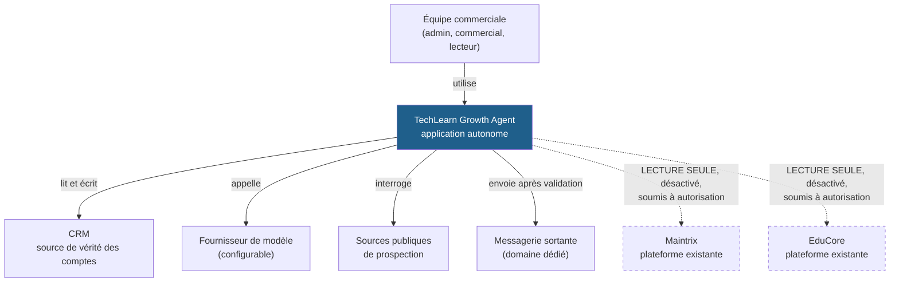
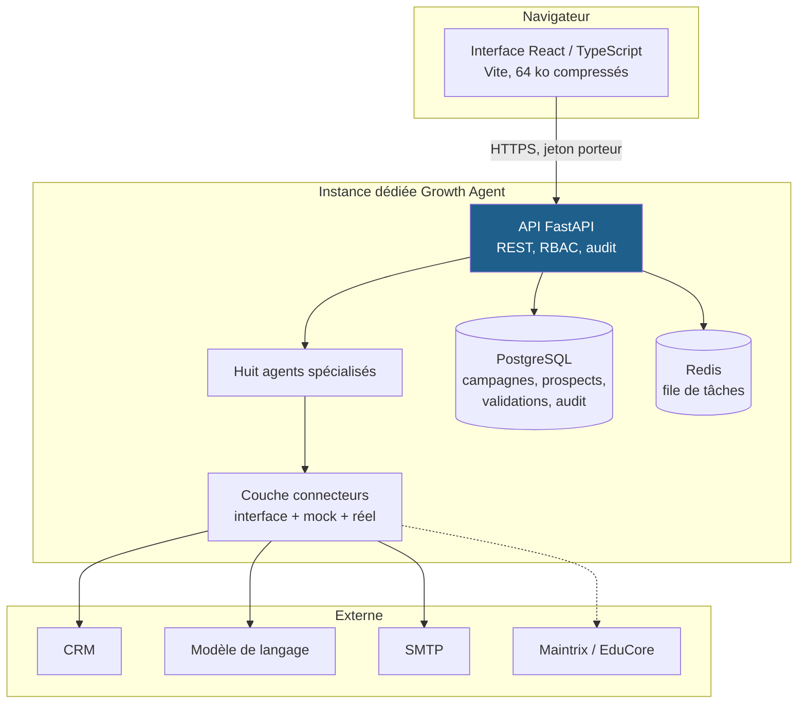
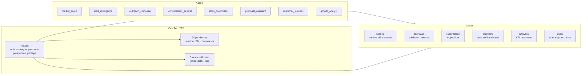
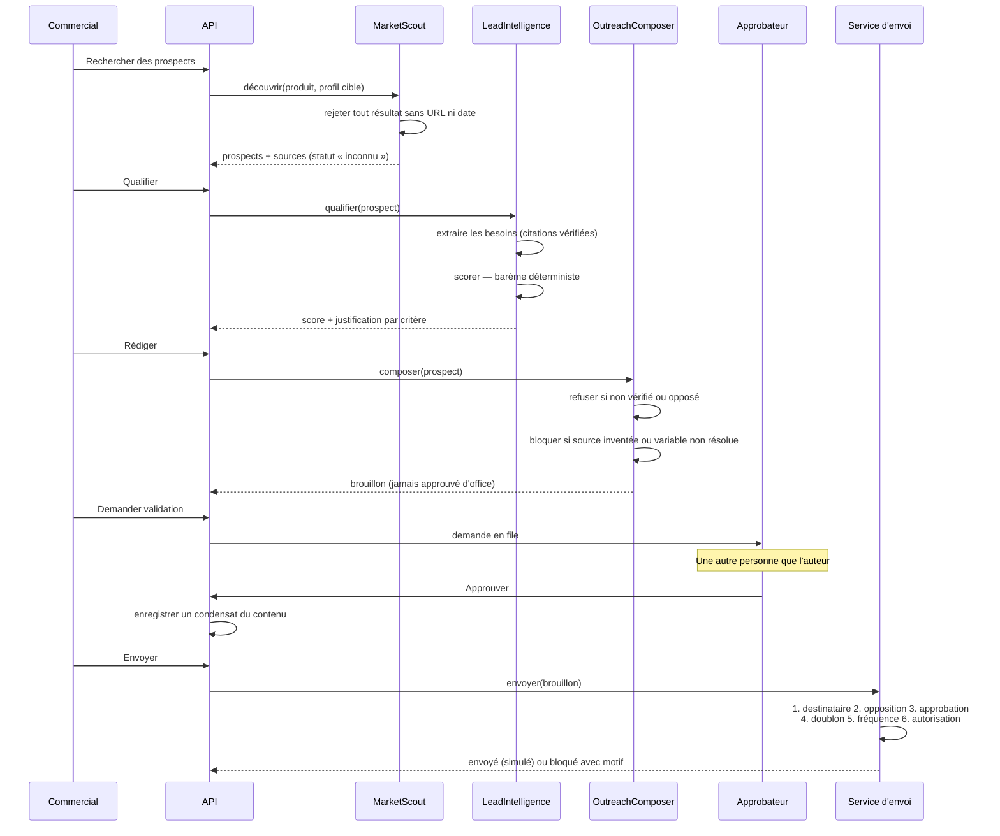

# Architecture

## Le problème posé

Vendre deux produits très différents — Maintrix pour l'industrie, EduCore pour
l'enseignement — avec une seule équipe commerciale et un seul outil, sans que
cet outil puisse toucher aux deux plateformes.

Cette dernière contrainte a façonné tout le reste.

## Niveau 1 — Contexte

Les traits pointillés ne sont pas décoratifs : ces deux liens **n'existent pas
aujourd'hui**. Les connecteurs correspondants refusent de s'initialiser tant
qu'une autorisation explicite n'a pas été accordée (voir
[11-dependances-autorisation.md](11-dependances-autorisation.md)).

## Niveau 2 — Conteneurs

### Pourquoi cette répartition

**PostgreSQL ne duplique pas le CRM.** Il stocke ce que le CRM ne sait pas
faire : la provenance des prospects, le détail des scores, les demandes de
validation, le journal d'audit. Les entreprises, contacts et opportunités
restent dans le CRM, référencés par la table `crm_mappings`. Dupliquer un CRM
produit deux vérités, dont une fausse.

**Redis est une file de tâches, pas un cache de données.** Aucun indicateur
n'y est stocké : les KPI sont recalculés depuis les événements à chaque appel.
Un compteur mis en cache finit toujours par mentir.

**n8n est optionnel et jamais source de vérité.** Il peut orchestrer des
automatisations externes. Si on le débranche, rien de métier ne disparaît.

## Niveau 3 — Composants de l'API

### Le point le plus important

`services/outreach.py` est **le seul endroit du code autorisé à déclencher un
envoi**. Aucun agent n'a accès à un fournisseur d'email. Cette contrainte n'est
pas une convention : les agents ne reçoivent tout simplement pas l'objet.

Six contrôles s'appliquent, dans cet ordre précis :

1. destinataire exploitable ;
2. **liste d'opposition** ;
3. approbation humaine valide, correspondant au contenu actuel ;
4. anti-doublon (sur le contenu, pas sur l'identifiant du brouillon) ;
5. plafonds de fréquence, par contact et par campagne ;
6. autorisation d'envoi réel — sinon, envoi simulé.

L'opposition passe **avant** l'approbation délibérément : un contact qui a
demandé à ne plus être sollicité doit être écarté même si un bug laissait
passer une approbation invalide.

## Décisions d'architecture

### ADR-001 — FastAPI, React, PostgreSQL plutôt qu'un socle intégré

**Alternatives examinées.** Un Django + templates aurait été plus rapide à
démarrer. Une solution sans code (Airtable, n8n seul) aurait évité tout
développement.

**Décision.** FastAPI + React + PostgreSQL.

**Pourquoi.** Le projet a trois exigences qu'une solution sans code ne tient
pas : un journal d'audit inviolable, une validation humaine qu'on ne peut pas
contourner, et des connecteurs interchangeables. Django aurait convenu, mais
la génération automatique du schéma OpenAPI par FastAPI évite de maintenir à
la main le contrat entre l'API et l'interface.

**Coût accepté.** Deux écosystèmes à maintenir au lieu d'un.

### ADR-002 — Interface de connecteur systématique, mock par défaut

**Décision.** Chaque dépendance externe est derrière une interface abstraite,
avec une implémentation mock complète et fonctionnelle.

**Pourquoi.** Trois bénéfices, dont deux inattendus au départ.

Le premier était prévu : pouvoir changer de CRM ou de fournisseur de modèle
sans réécrire les agents.

Le deuxième l'était moins : **la totalité de la suite de tests tourne hors
ligne et sans coût**. 225 tests, aucune clé d'API, aucun quota consommé. Le
parcours commercial complet est testé de bout en bout.

Le troisième est le plus important : **l'état par défaut est inoffensif**. Une
configuration incomplète ne provoque pas un appel réel « au cas où » — elle
retombe sur le mock. Il est impossible d'envoyer un email ou d'appeler Maintrix
par accident.

### ADR-003 — Scoring déterministe, modèle de langage cantonné à l'extraction

**Décision.** Le score des prospects est calculé par du code, pas par un
modèle. Le modèle ne fait qu'une chose : repérer, dans des extraits de pages,
des citations de besoin. Et ces citations sont **vérifiées** : si le texte
proposé ne figure pas littéralement dans une source, il est écarté.

**Pourquoi.** Un score produit par un modèle n'est ni reproductible, ni
explicable, ni contestable. Il change d'une version à l'autre du modèle, et on
ne peut pas dire à un commercial pourquoi tel prospect vaut 72 plutôt que 65.

Le barème imposé — secteur 25, besoin documenté 25, décideur 20, faisabilité
15, potentiel 15 — est implémenté tel quel, et chaque point attribué cite la
preuve qui le justifie.

**Conséquence qu'il faut assumer.** Le système note mal un prospect dont le
besoin est réel mais formulé d'une manière qu'aucune source ne documente. C'est
voulu : mieux vaut un faux négatif qu'un prospect noté sur une intuition.

### ADR-004 — Les indicateurs ne sont jamais stockés

**Décision.** Aucun compteur en base. Tout KPI est une agrégation des
événements, recalculée à chaque appel.

**Pourquoi.** Un compteur stocké diverge : un incident, une reprise, un
traitement rejoué, et il devient faux — sans que personne ne s'en aperçoive.
Un KPI recalculé ne peut pas mentir plus longtemps que les événements dont il
dérive.

**Coût accepté.** Des agrégations à chaque appel. Aux volumes visés (quelques
milliers d'événements), c'est négligeable. Au-delà, une vue matérialisée
rafraîchie périodiquement fera l'affaire — en conservant le recalcul comme
référence.

**Corollaire.** Quand le dénominateur est nul, le taux vaut `null`, pas zéro.
L'interface affiche « Aucun envoi » et non « 0 % » : une absence de mesure
n'est pas une contre-performance.

### ADR-005 — Deux produits, une base, un cloisonnement strict

**Alternatives examinées.** Deux instances séparées. Ou une base par produit.

**Décision.** Une instance, une base, et un `product_id` obligatoire sur toute
donnée commerciale.

**Pourquoi.** Deux instances doubleraient les coûts d'exploitation pour une
seule équipe, et rendraient impossible une vue consolidée. Le cloisonnement
est assuré par le modèle de données : les campagnes, les prospects, les
gabarits et les oppositions de portée produit portent tous leur produit.

**Garde-fous.** Un gabarit Maintrix ne peut pas servir à un prospect EduCore
(l'agent refuse). Un profil cible ne peut pas franchir la frontière (l'API
refuse). Les KPI sont calculés produit par produit. Trois tests vérifient ce
cloisonnement.

### ADR-006 — PBKDF2 de la bibliothèque standard plutôt que bcrypt

**Décision.** PBKDF2-HMAC-SHA256, 390 000 itérations, sans dépendance externe.

**Pourquoi.** La première version utilisait `passlib` + `bcrypt`. Une
incompatibilité entre les deux bibliothèques provoquait une erreur au premier
hachage — rattrapée par un repli, mais avec une trace d'erreur dans les logs à
chaque démarrage. Pour une fonction aussi critique, une dépendance native qui
casse silencieusement est un mauvais compromis.

PBKDF2 à 390 000 itérations correspond aux recommandations OWASP actuelles. Le
format stocké (`pbkdf2_sha256$<itérations>$<sel>$<clé>`) permet d'augmenter le
coût plus tard sans invalider les condensats existants, et `needs_rehash` le
signale.

## Flux de données

## Ce que cette architecture ne fait pas

Dire ce qu'un système ne fait pas vaut souvent mieux que vanter ce qu'il fait.

- **Pas de montée en charge horizontale en l'état.** La limitation de débit est
  en mémoire ; derrière plusieurs répliques, elle devient approximative. À
  déporter dans Redis le jour où ce sera nécessaire.
- **Pas de travail asynchrone.** Redis est présent, aucun worker ne l'utilise
  encore. La découverte et la qualification sont synchrones, ce qui convient
  aux volumes visés et deviendra inconfortable au-delà de quelques centaines de
  prospects par lot.
- **Pas de détection des clients existants.** Voir D3 dans le registre des
  dépendances. À traiter manuellement avant chaque campagne.
- **Pas d'envoi réel.** Volontairement, tant que le domaine d'expédition et le
  cadre juridique ne sont pas tranchés.
